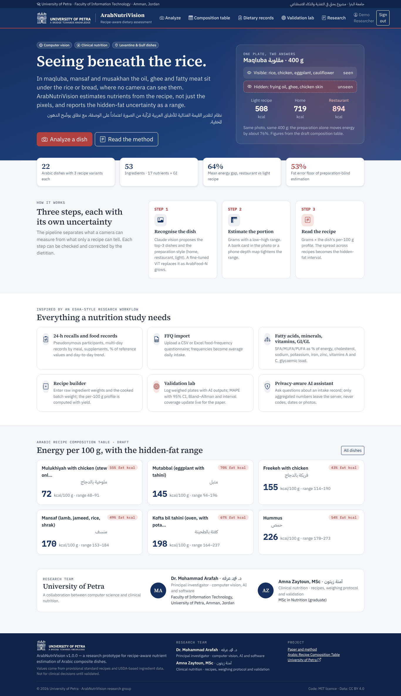
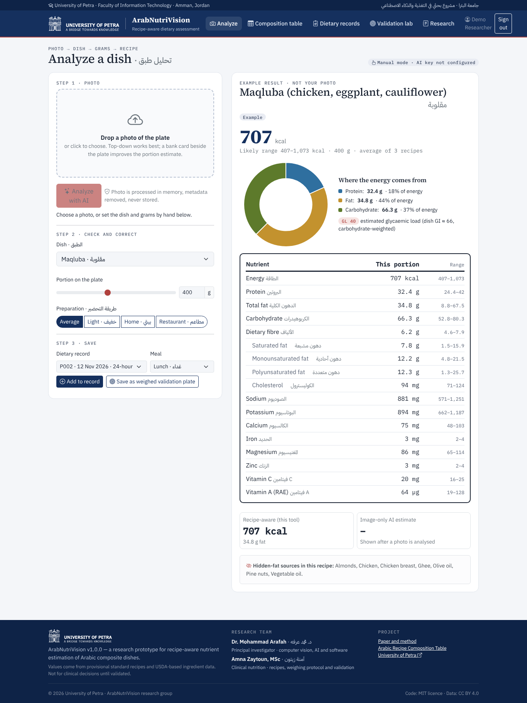
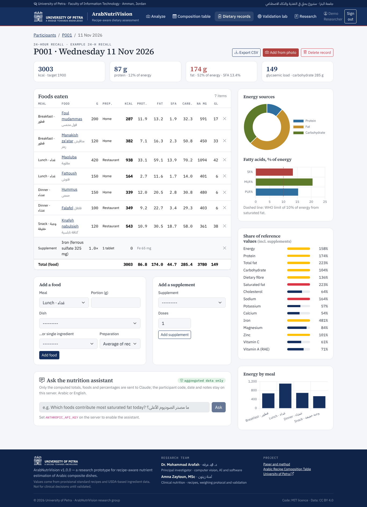
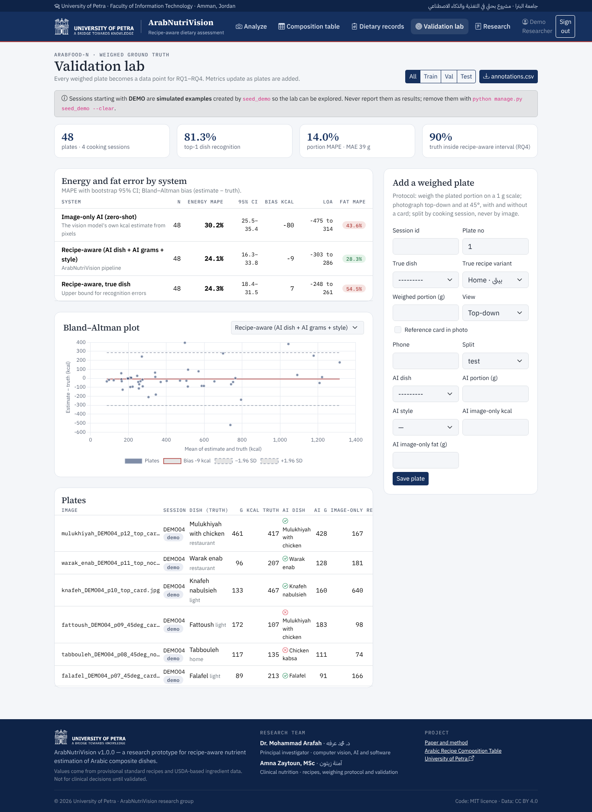

<p align="center">
  
</p>

<h1 align="center">ArabNutriVision</h1>
<p align="center"><b>Recipe-aware computer vision for nutrient estimation of Arabic composite dishes</b><br>
<span dir="rtl">تقدير القيمة الغذائية للأطباق العربية المركّبة من الصورة اعتماداً على الوصفة</span></p>

<p align="center">
  
  
  
  
  
  
</p>

---

In maqluba, mansaf or musakhan the frying oil, ghee and fatty meat sit **under the rice or bread**, where no camera can see them. Image-only calorie apps and general multimodal AI models therefore miss most of the variation in fat. ArabNutriVision makes the **recipe** the unit of estimation:

```
photo ─► (1) recognise dish + preparation style ─► (2) portion in grams with a range ─► (3) grams × per-100 g recipe profile
                                                                                         └─ spread of home / restaurant / light recipes = hidden-fat interval
```

This repository holds the **web application** (Django + Bootstrap) and the **research code** behind the accompanying paper.

The interface is fully **bilingual (English / العربية)** with right-to-left layout for Arabic; switch language from the top bar. Translations live in `locale/ar/LC_MESSAGES/django.po` (compile with `python manage.py compilemessages`).

| | |
|---|---|
|  |  |
|  |  |

## Research team

| | Role |
|---|---|
| **Dr. Mohammad Arafah** · د. محمد عرفه — Faculty of Information Technology, University of Petra, Amman, Jordan | Principal investigator: computer vision, AI, software |
| **Amna Zaytoun, MSc** · آمنة زيتون — Nutrition | Recipes, weighing protocol, nutritional validation |

## What the application does

| Module | Description |
|---|---|
| **Analyze** | Upload a plate photo. An open-source CLIP model (ViT-B/32, via transformers.js/ONNX) runs **inside the browser** and proposes the dish (top-3) and a preparation style; the photo never leaves the device and no AI API or key is used. The app computes recipe-aware nutrients with an interval. |
| **Arabic Recipe Composition Table** | 22 Levantine/Gulf dishes × 3 recipe variants, 53 ingredients, 17 nutrients (macronutrients, SFA/MUFA/PUFA, cholesterol, Na, K, Ca, Fe, Mg, Zn, vitamins A and C) plus carbohydrate-weighted GI and glycaemic load. Per-dish hidden-fat sensitivity and gap decomposition. |
| **Recipe builder** | Raw ingredient grams + cooked batch weight → per-100 g profile with yield (EuroFIR/FAO recipe-calculation logic). |
| **Dietary records** | Pseudonymous participants, 24-h recalls, food records and menus by meal, dietary supplements, % of reference values, SFA % energy against the WHO limit, multi-day usual intake, CSV export. |
| **FFQ import** | CSV or Excel food-frequency questionnaire → average daily intake. |
| **Validation lab** | Log weighed plates (ArabFood-N protocol) with AI outputs; top-1 accuracy, portion MAE/MAPE, energy and fat MAPE with bootstrap 95% CI, Bland–Altman plot, interval coverage, `annotations.csv` export. These are the paper's RQ1–RQ4 metrics. |
| **Nutrition insights** | Rule-based checks of each record against WHO/FDA reference values (fat and SFA % energy, sodium, fibre, glycaemic load, hidden-fat dishes); no external AI. |
| **Research page** | The paper's thesis, the error-budget simulation and the gap decomposition, rendered from `research/results`. |

## Quick start

```bash
git clone https://github.com/marafah/ArabNutriVision.git
cd ArabNutriVision
python -m venv .venv && source .venv/bin/activate        # Windows: .venv\Scripts\activate
pip install -r requirements.txt
python manage.py migrate
python manage.py load_reference_data                     # composition table
python manage.py seed_demo                               # optional demo account: demo / arabnutrivision-demo
python manage.py createsuperuser                         # your own account
python manage.py runserver
```

Open http://127.0.0.1:8000. Run the tests with `python manage.py test nutrition` and, for the research code, `cd research && pytest -q`.

Bootstrap 5.3.3, Bootstrap Icons 1.11.3, Chart.js 4.4.1, transformers.js 2.17.2 (ONNX Runtime Web) and the IBM Plex / Source Serif fonts are vendored under `nutrition/static/vendor`, so the app needs no CDN. The CLIP weights (about 90 MB) are fetched once from Hugging Face by the browser and cached.

### Configuration (`.env`)

| Variable | Purpose |
|---|---|
| `DATABASE_URL` | Optional PostgreSQL database for permanent records |
| `ANV_ADMIN_USERNAME`, `ANV_ADMIN_PASSWORD` | Admin account created at deploy time |
| `DJANGO_SECRET_KEY`, `DJANGO_DEBUG=0`, `DJANGO_ALLOWED_HOSTS` | Production settings |

### Deploy (Render, free)

1. Sign in at [render.com](https://render.com) with GitHub.
2. **New → Blueprint**, choose `marafah/ArabNutriVision`; Render reads `render.yaml`.
3. Render generates `ANV_ADMIN_PASSWORD` (admin user `marafah`); read it under the service's **Environment** tab.
4. After the build, the app is live at `https://arabnutrivision.onrender.com` (or the name Render assigns).

The build loads the composition table, a demo account (`demo` / `arabnutrivision-demo`, example data only) and the admin account.
With the default SQLite database, data entered online are reset when the free service restarts; set `DATABASE_URL`
to a PostgreSQL database (Render, Neon, Supabase) to keep records permanently. Free services sleep after 15 minutes
without visits; the workflow `.github/workflows/keepalive.yml` pings the site every 10 minutes so it stays awake
(a short loading page can still appear for about a minute right after each new deploy).

## Research code (`research/`)

| Path | Content |
|---|---|
| `research/data/` | Draft recipes (`recipes.json`), ingredient table (`ingredients.csv`, `ingredients_ext.csv`), generated composition table |
| `research/src/anv/` | Composition, portion (card scaling, depth volume), estimation, evaluation metrics |
| `research/scripts/paper_analysis.py` | Analyses reported in the paper: variant spread, gap decomposition, preparation-blind error floor, Monte Carlo error budget, oil sensitivity → `research/results/` (300-dpi PNG + PDF figures) |
| `research/scripts/benchmark_vlm.py` | Zero-shot VLM vs recipe-aware benchmark on weighed images |
| `research/scripts/train_classifier.py` | ViT fine-tuning on ArabFood-N (split by cooking session) |

```bash
cd research && pip install numpy scipy matplotlib pytest && python scripts/paper_analysis.py
```

## Data status and limitations

All recipes are **provisional standard recipes**; ingredient values are USDA-based approximations, and two ingredients (reconstituted jameed sauce, desalted white cheese) are explicit placeholders. They will be replaced by weighed recipes, reference-book analyses and laboratory proximate analysis before any clinical use. Validation sessions whose id starts with `DEMO` are simulated and must never be reported as results.

## How to cite

> Arafah M, Zaytoun A. Seeing beneath the rice: recipe-aware estimation of hidden fat in Arabic composite dishes from food images. University of Petra; 2026. Manuscript in preparation.

## Licence

Code: MIT. Composition data and figures: CC BY 4.0. The University of Petra name and logo belong to the University of Petra and are used to identify the authors' affiliation.
